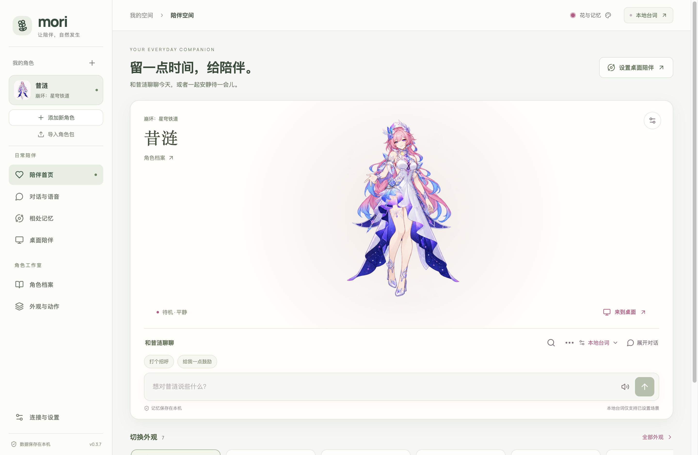

# Demiurge · 与你，此刻

一个本地优先的角色陪伴与桌宠应用。无需 API 即可使用预制外观、动作和已编写的日常台词；按需接入自己的模型获得自由聊天、资料整理或生成能力。**角色建档和聊天不强制使用 Tavily。**

**当前代码版本：0.3.31。** Demiurge 原名 Mori。 本仓库提供 Demiurge 的源代码、自动测试和 AI 生成的示例角色素材。源代码使用 [MIT 许可证](LICENSE)；角色素材、字体及第三方运行库的权利说明见 [THIRD_PARTY.md](docs/THIRD_PARTY.md) 和 [素材说明](public/art/README.md)。

这是源码发布，仓库中不包含 macOS 应用包。克隆后可按下方步骤运行，也可参考 [macOS 打包说明](docs/MACOS_RELEASE.md) 自行构建 Apple Silicon 应用。现有本机验收包尚未签名、公证；历史文档中的 `release/`、`artifacts/` 与 `.local/` 是本地生成路径，不表示仓库附带这些文件。首次使用见 [Demiurge 使用指南](docs/DEMIURGE_USER_GUIDE.md)。

**画风与成品的区别：**「清爽贴纸」已加入自动制作选项，但当前内置成品仍是下面的七套外观；读书、掌机支持制作和播放，目前也没有对应的内置动作素材。

0.3.31 每个角色按自己的性格生活：最爱的活动、空闲小习惯、移动方式（走、跑、蹦、飞）和摸头戳脸时的反应都来自角色档案；被召唤时从屏幕一侧跑进来，空闲时坐下、趴着、东张西望或哼歌，不再呆站；打字或很久没人理她时会去你的窗口，边做自己的事边偷看你，偶尔主动找你；鼠标在头上来回晃就是摸头；工具栏总在脚下；切换桌面或全屏应用时她会跟过来，从切换方向跑进来；播放时约束头部大小，站立帧里偏大偏小的头会被拉回一致。

0.3.29 可以用自己的图片做应用图标：把 PNG 放在 `private/app-icon.png`（已被 Git 忽略，不会上传），打包时它会放在白色圆角底板上，按图中内容的重心居中并留出边距（主体偏下的图片会被提到中间），用作应用、程序坞和侧栏图标；没有这张图时使用自带的图标。0.3.30 起侧栏图标与下方角色头像同宽并居中。

0.3.28 图标改为 Demiurge 的张量方块：一个由 4×4×4 个小方块组成的立方体，光从缝隙里透出来，几个小方块正从表面浮起，像在运算。（0.3.27 的方块环图标已替换。）

0.3.26 改名为 Demiurge，并换了新图标（应用、程序坞和菜单都显示 Demiurge；数据目录、已保存的密钥和系统权限沿用 Mori 的，不需要迁移）。你在某个窗口里打字时，她会跑到那个窗口上沿坐下或趴着看你，有时也在那里做自己的事；窗口上方没有空间时站在旁边。慢慢拖动窗口时她会跟着跑、保持在窗口上；拖得太快她会摔到屏幕底部，然后跑回去，或坐着生气等你摸头哄她。新增心情：被陪伴会开心，长时间没人理会寂寞，被吵醒、被打断或被甩下窗口会生气，头上会出现 ♪、…、💢，聊天时模型也会知道她的心情。寂寞时她会主动请你陪她聊天或摸摸头，生气时只想被哄。新增「坐下」「趴着」两个动作：新建任务默认包含，已完成的任务可以只补画这两个动作（清晰优先约 6 次图像请求），不必重新制作整套外观。

0.3.25 桌宠会看你在做什么再决定自己做什么：你在编辑器、终端或文档里打字时，她走到你窗口旁边（有空位就不挡住窗口），安静地看着，时不时转头看一眼你的屏幕，或拿出自己的笔记本电脑、日记本、书陪你一起做事；开会时她让开、不说话；你离开一阵子她就自己玩掌机、吃点心、听歌，离开久了会打盹。她只读取前台应用的名称、窗口位置，以及距离上次按键和移动鼠标过了几秒，不读取窗口标题、内容或按键。窗口信息改为持续更新（约每 0.25 秒一次），站在窗口上时跟得更紧，也不再把透明或不可见的窗口当成可站的地方。一起玩的小游戏在桌宠里变成她头顶的小气泡，由她用动作表演（藏星星、猜对时跳一下、猜错时摇头、读书时捧着书），接星星时星星落在她身边，不再用方框挡住她。应用首页的人物在窗口变宽变窄时始终居中。

0.3.24 修正 0.3.23 打开已确认外观时提示「动画图像或时序已经改变，请重新逐帧核对」、无法读取工作区的问题。0.3.23 在启动时改写了已有外观的动作顺序，而已确认外观的核对记录包含动作顺序，因此存档被拒绝（磁盘上的文件没有被改动）。现在改用眨眼静止姿势只发生在播放时，存档和核对记录保持原样；启动时的整理即使保存失败，也会按磁盘上的原样打开工作区，不再锁住。

0.3.23 桌宠可以待在屏幕上任何地方：放到哪里就停在哪里，不再受重力落回屏幕底部，松手时离窗口上沿或地面很近才会站上去；收起后再打开会回到原位。工具栏平时隐藏，鼠标移到她脚下才出现，并加入大小滑块；她说的话在头顶、工具栏在脚下，靠近屏幕边缘时自动换位，不再重叠。去掉了人物下方的名字条。点工具栏的对话按钮，可以在她脚下直接输入并收到头顶的回复，不用打开主窗口。另外修正了动作结束时头部突然变大：自动制作的待机姿势原来是单独画的确认图，头身比例和图像模型画的动作不同；现在待机改用眨眼动作里同样画法的静止姿势，无需重新制作。

0.3.22 修正要求先经过对话模型和搜索：对话模型对照图片理解你的要求并决定要查证的细节，搜索服务查找资料，再由对话模型为图像模型写出具体修正说明；图像模型收不到原始修正文字。修正记录显示对话模型的理解和引用的资料。修正因此需要配置对话模型和搜索服务，每次修正另有约 2 次对话请求和 1 次搜索。

0.3.21 默认「清晰优先」制作动作：每张图只画两到四个姿势，生活、睡觉和跑步等十二帧动作分三张图，眨眼、说话、表情等短动作分两张图，再按共享的中心线和脚底线拼回同一动作。动作帧的像素高度约是之前的 1.8–2.5 倍，接近待机图；完整动作包约 53 次图像请求（节省模式 21 次）。大图集按页保存为本机文件，桌宠只解码正在播放的那一页，工作区文件不再包含整张图集。已完成的旧任务不会自动变清晰，请**新建制作任务**；「节省请求」仍可在制作页选择。

0.3.20 让角色在桌面上生活：她站在屏幕底部、任意窗口的上沿或桌面图标上，按精力、好奇心和亲近度自己走动、爬上窗口、从窗口边上偷看你、跟去你刚切换的窗口、困了在角落打盹；站着的窗口被拖动时会跟着走，窗口关闭或被盖住会掉下来。被拖起时像钟摆一样晃动，松手后受重力落到下方的窗口或地面并有落地动作。主动邀请会等你停顿时才出现，间隔至少十几分钟、每小时最多两次；闲聊每小时最多五句；离开五分钟以上回来时会打招呼。桌宠可在身上滚动或捏合自由缩放（45%–260%），应用首页人物也可滚动、捏合或在人物设置中缩放。外观卡片可删除。眨眼、说话、点头、招手和表情帧直接对齐待机帧，循环动作去掉横向漂移；已完成的任务需在制作页点「重新整理动画（不调用模型）」后生效。

0.3.9 对齐动作制作流程：默认清爽贴纸与完整动作包，生活／跑步动作的进入、循环、退出各四帧；支持坐下、躺下和桌椅道具，共享已完成动作参考，固定位置配准并保留原始像素。请**新建制作任务**使用新版，旧任务仍按原布局续跑。见 [0.3.9 制作流程更新](docs/MORI_0_3_9_RELEASE.md)。

0.3.8 将 Anime Codex 的四向跑动、被拎起、睡醒与跑停过渡、桌面感知和自主探索接入 Demiurge，修复桌宠邀请无法接受的问题。入口、兼容性及验证边界见 [迁移说明](docs/ANIME_CODEX_MIGRATION.md)。已有外观需要补齐新动作后才能播放，不会自动生成或替换素材。

0.3.7 重整了工作区：单侧栏区分「日常陪伴」与「角色工作室」，首页把角色和输入框放在同一张卡片里，外观页优先展示自动制作与已保存外观，导入工具和动作调节按需展开。视觉与验收说明见 [0.3.7 界面更新](docs/MORI_0_3_7_RELEASE.md)。



初次启动默认本地台词模式，明确标注已编写的回应，不伪装成模型回答。昔涟保留原作画风、精绘、Q 版、飞天小女警、复古像素、8-bit 和低多边形 3D 七套外观，每套都有 16 张姿势帧，支持待机呼吸、眨眼、口型、招呼、点头和闭眼休息。模型对话需配置真实服务，缺少配置不会静默切换成本地回答。昔涟初始语气依据已读取的 HoYoWiki 问候与爱好语音提炼；本地互动台词是可编辑的二次创作，未整理的剧情保持未知。

新增人物支持本机草稿恢复、同名同作品档案续接和五项准备进度；切换人物会记住各自的已确认外观。「桌宠窗口」提供三档大小与实时预览，逐帧角色只在可见像素上响应触摸。对话按角色台词和近期表达组织上下文，并再次检查动作是否符合语境。实现、验证与能力边界见 [本轮产品完善记录](docs/PRODUCT_REFINEMENT_2026_10_07.md)。

「角色档案 → 角色试聊」支持独立的多轮对话，每段最多 8 轮。可以逐条标记是否贴合角色、记录语气或设定问题，再复制摘要并调整档案；试聊不写入正式聊天或个人记忆，关闭窗口后清除。新角色首页会按现有资料推荐下一步，不要求完整导入的角色包重新补原图。见 [第二轮完善记录](docs/PRODUCT_REFINEMENT_ROUND2_2026_10_07.md)。

自动制作新增「先看角色图再继续」、可保存的外观要求、自然／轻柔／活泼动作气质，以及可选实验性八帧。四帧仍为默认，八帧需要横向图像编辑支持；旧任务可继续。GitHub 调研、实现与验证边界见 [2026-10-22 制作改进](docs/PET_PRODUCTION_UPGRADE_2026_10_22.md)。

0.3.0 进一步支持每种画风生成 1–3 张形象候选、选定后制作动作、只重绘一个不满意的动作，或修正角色形象后重做该画风。每份修正版保留原任务和原成品，核对后再启用。连接设置新增完整工作区 ZIP 备份与恢复，包含聊天、记忆、模型和制作任务；存档损坏时可显式恢复上一份有效存档，密钥解密失败也能继续本地陪伴。具体交付和测试见 [0.3.0 完善记录](docs/MORI_0_3_RELEASE.md)。

0.3.1 补上视觉核对：候选图可与任意一张参考图并排放大，支持 100%–300% 缩放、透明格和深浅底色；修正版可与来源成品同时试播同一个动作并反复重播。查看、放大和试播不会新增模型请求，也不会替你选定候选。实现与截图见 [0.3.1 视觉核对改进](docs/MORI_0_3_1_RELEASE.md)。

0.3.2 把形象修正提前到候选阶段：点击「修正这张」，填写要求后仅新增一次图像编辑。新旧候选同时保留，并停下来等待选择，再制作动作；修图失败仍可使用原候选，本机保存恢复不会再次请求模型。见 [0.3.2 候选修图改进](docs/MORI_0_3_2_RELEASE.md)。

0.3.3 增加独立画风参考：角色原图保持身份与服装，另一张图片只参考线条、上色方式和材质；任务保存自己的参考副本，动作沿用选定角色图。候选核对新增 96／160／240 像素高度的小尺寸预览，便于判断缩小后的脸部与轮廓。见 [0.3.3 画风参考与预览](docs/MORI_0_3_3_RELEASE.md)。

0.3.6 新增读书与掌机活动：每组八帧，包含进入、循环与收起道具；支持制作审核、成品试播和桌宠工具栏，活动约一分钟后回到待机。见 [0.3.6 生活活动说明](docs/MORI_0_3_6_RELEASE.md)。

0.3.5 借鉴本机 Anime Codex：新增清爽贴纸画风，自动整理略有尺寸偏差的图集，排除只有透明像素或轻微噪点变化的无效动作，并清理贴纸成品的低透明度残留。见 [0.3.5 适配说明](docs/MORI_0_3_5_RELEASE.md)。

0.3.4 让多候选带有可比较的设计方向：「均衡表现」「鲜明轮廓」「柔和神态」。生成前可查看说明，也可选择同一方向微调；方向随候选保存，修图与动作沿用选定外观。旧任务保持原有方式。见 [0.3.4 候选设计方向](docs/MORI_0_3_4_RELEASE.md)。

## 不配置模型也能使用

1. 打开左侧「角色包与本地互动 → 精选角色包」，选择七种画风之一并试播，点击「使用这套角色包」。预览本身不会切换角色。新增其他人物时使用「添加角色」，默认无需模型；保存后进入其独立的外观与动作设置。
2. 首页点击人物头顶或身体，分别触发摸头与戳一戳；休息和唤醒位于折叠的人物设置中。桌宠支持点击、拖动后回应及休息。动作只使用素材实际具备的能力，播放完整动作后恢复待机；主动招呼受角色性格、优先级和冷却限制。
3. 在人物下方输入消息，平时只显示角色最近的回复气泡；点击「展开对话」查看保存的记录。输入区右上角的对话选项可选择「本地台词」，试试“你好”“给我一点鼓励”“晚安”“醒醒”。不支持的问题明确回应范围，不生成记忆，也不自动调用 TTS。选择「模型对话」后才使用聊天 API。人物设置与服务配置分组默认收起。
4. 在角色包的「互动台词」中按场景编辑，每行一句。导出当前角色包可以携带图片、逐帧动作、设定与台词，离线导入后继续使用；不含聊天、个人记忆、配置或密钥。

七套动画基于用户已保留的各画风立绘，使用内置绘图独立制作姿势帧；播放不需要图像 API。原版、8-bit、低多边形和飞天小女警已更新为 v3，使用四组较大姿势源图，并支持按语音音量选择闭嘴、小口型和大口型；精绘、Q 版与复古像素继续使用 v2。原静态文件与早期素材保留。当前没有走路、摇头、跳跃、跳舞或投喂帧；低多边形 3D 也是 PNG 动画。部件拼装、3D 批量画风渲染和 VPet/Shimeji 原包兼容尚未实现。格式及行为边界见 [角色包与本地互动](docs/CHARACTER_PACKS.md)，当前素材及验证见 [四画风动作 v3](docs/CYRENE_MOTION_V3.md)，历史修复见 [v2](docs/CYRENE_MOTION_V2.md) 和 [v1](docs/CYRENE_MOTION_V1.md)。

生成动画的透明背景与播放检查不能保证没有多余手臂。新的候选需要逐帧核对肢体、身份和衔接，审核绑定当前图像与时序；内置素材发布也执行相同的像素验收。非像素动画保留真实帧纹理，像素动画按声明的像素网格播放；当前内置拼图源帧并非全尺寸高清。工作台会提示明显放大，图集超限不会静默降清晰度。完整规则见 [动画质量与分辨率](docs/ANIMATION_QUALITY.md)。

## 启动桌面开发版

需要 Node.js 22.12+、pnpm 和能够运行 Electron 的桌面环境。

```sh
git clone https://github.com/BubbleNNN/Demiurge.git
cd Demiurge
pnpm install --frozen-lockfile
pnpm desktop
```

macOS 在完成依赖安装后可以双击 **Start Demiurge Dev.command**。它启动 Vite 热更新与真实 Electron 主进程；不需要先构建网页。只有使用 Live2D 模型时才需要额外执行 `pnpm setup:live2d`。Core 从厂商服务器下载到 Git 忽略的 `public/vendor`，不随源码发布。

- `pnpm desktop`：桌面开发版，数据默认在项目 `.local/development-v2`。
- `pnpm dev`：仅用于浏览器查看界面。浏览器不接收 API Key，不提供原生文件导入或真实 API 调用。
- `pnpm build && pnpm start`：运行本地构建；默认使用系统应用数据目录。
- `pnpm check`：TypeScript 与自动测试。
- `MORI_DATA_DIR=/absolute/path pnpm desktop`：指定隔离数据目录。

开发服务器只监听 `127.0.0.1:5173`，端口被占用会明确失败，不会连接其他服务器。关闭 Electron 会停止配套 Vite 进程。

## 按功能逐块调试

应用左侧按「人物陪伴、对话语音、角色资料、外观动作、相处记忆、桌宠窗口、连接设置」分区。主页保持人物下方的紧凑输入；完整记录在「对话语音」单独打开。当前集中调试外观动作中的自动 2D 桌宠制作流程。

```sh
pnpm desktop --module companion  # 人物展示与互动
pnpm desktop --module chat       # 完整对话与语音
pnpm desktop --module appearance # 外观、动画与模型
```

其他入口：`characters`、`memories`、`desktop`、`settings`。入口参数只决定本次打开的页面，复用真实开发工作区，不更改保存的配置。模块边界、完整命令和验收项见 [功能模块与逐块调试](docs/FUNCTION_MODULES.md)。

## 已实现

| 功能       | 当前行为                                                                                                                             |
| ---------- | ------------------------------------------------------------------------------------------------------------------------------------ |
| 角色主题   | 昔涟默认粉白与淡紫；按名字/外貌或检索建议选择主题。支持五套配色与自定义强调色，各角色独立保存                                        |
| 新界面     | 居中角色舞台、当前回复气泡、人物下方输入与按需展开记录；外观工作台、角色档案、记忆与折叠服务设置；本地 Manrope 字体与中文宋体姓名    |
| 内置外观   | 七套画风各 16 个姿势帧；待机、眨眼、口型、招呼、点头与休息；复古像素 64×96 / 32 色，8-bit 96×128 / 16 色；旧素材保留                 |
| 动画素材   | 导入 Aseprite JSON + PNG 或 Demiurge 动画包；完整姿势帧、制作时长、有限动作、静音闭嘴、暂停与减少动态效果                                |
| 图像生成   | 四种画风：原作、8bit、3D、Q版；Q版先检索并核对同角色已有 Q 版形象，没有可用参考时用 Anime Codex 芙宁娜贴纸画风；原图输入，人工核对后扩展表情 |
| 自动桌宠   | 四种画风、每画风 1–3 张候选、四帧或实验性八帧、三档动作气质；选定形象后制作动作，支持单动作或形象修正版、暂停续做和逐帧核对          |
| 自动收图   | 从名字匹配的星穹铁道社区索引、已有资料网页或 Wiki 图片接口下载原图；保存尺寸和来源，可直接用作静态立绘                               |
| 3D 制作    | 独立 Meshy Key，主参考原图生成模型后绑定骨骼，下载自包含 GLB 并在主舞台及桌宠中运行；本机任务记录支持继续查询                        |
| Live2D     | 导入单个模型的 `.model3.json` 或 ZIP；读取表情和动作组，视线跟随、物理摆动、情绪/动作映射、音量口型                                  |
| VRM 3D     | 导入自包含 `.vrm`（0.x/1.0）；静止待机、有限招呼/点头/摇头/小跳、眨眼、视线和音量口型                                                |
| 聊天       | OpenAI Chat Completions 与 Claude / Anthropic Messages；剧情阶段、相处关系、语气规则、相关资料和记忆构成上下文；动作受素材与情绪限制 |
| 对话整理   | 本机搜索、回到原消息、复制回复、文本导出、停止等待、三档近期回顾长度；回复生成后写盘失败可只重试本机保存                             |
| 角色一致性 | 可编辑剧情阶段、相处关系、语气规则、避免事项和创作设定；来源事实与私设分开，默认避免主动剧透，支持独立语气试聊                       |
| 记忆整理   | 按角色检索相关记忆，支持搜索、置顶、编辑、删除和暂不用于对话                                                                         |
| 语音       | 独立 TTS Key、Base URL、模型、音色和语速；手动朗读与可选自动朗读                                                                     |
| 资料       | 模型草稿、网页链接、手动设定；自动搜集可选 Claude 原生搜索、SearXNG、MediaWiki 或 Tavily，来源与台词依据分开保存                     |
| 桌宠       | 原生透明置顶窗口、拖拽、点击互动、聊天、透明区域穿透和主窗口状态同步                                                                 |
| 本地存储   | 角色、图片、聊天、记忆持久化；多窗口按修改字段合并，冲突保留草稿；密钥由 Electron safeStorage 加密，系统无可靠加密时只保留在内存     |
| 备份恢复   | 完整工作区 ZIP 含模型和制作任务，不含密钥；校验后导入，保留导入前副本，重启完成恢复；上一有效存档和密钥故障均有独立恢复入口          |
| 角色包     | 精选素材预览与启用；JSON 携带角色档案、参考原图、图片、逐帧时序及本地台词；不包含密钥、聊天、记忆或本机模型文件                      |
| 本地陪伴   | 可编辑场景台词、明确关键词匹配、点击/拖动/休息/唤醒；性格控制主动间隔，动作优先级与冷却阻止频繁打断，无模型请求                      |

## 接入 API

在左下角「连接与设置」填写对应服务。聊天、图像、3D 建模和 TTS 使用各自的配置。

1. **对话**：API Key、接口协议、请求地址、模型 ID。支持 OpenAI Chat Completions 与 Claude / Anthropic Messages。「服务基础地址」按所选协议构造请求：OpenAI 追加 `/chat/completions`；Claude 使用 `/v1/messages`，已含 `/v1` 时不会重复。也可选择「完整请求地址」直接使用填写的 URL。Claude Code 用户可填写相同的 `ANTHROPIC_BASE_URL`，密钥发送方式对应 `ANTHROPIC_AUTH_TOKEN`（Bearer）或 `ANTHROPIC_API_KEY`（x-api-key）。Claude 使用结构化工具参数返回角色对白、情绪与动作；工具只提交数据，不执行命令。服务需支持相应协议和结构化结果，完整 URL 模式不会自动转换协议。
2. **资料搜索（选配）**：选择 Claude 原生搜索、SearXNG、公开 Wiki、Tavily，或关闭联网搜索。Claude 沿用聊天 key，服务需支持原生 `web_search`；SearXNG 需要可用实例地址并启用 JSON 结果；Wiki 需要支持公开读取的 MediaWiki API 地址；只有 Tavily 需要 Tavily key。「保存并测试搜索」实际检索昔涟，检查接口与名称匹配；完整建档还会核对人物身份。测试不会建立档案或写聊天记录。
3. **图像**：API Key、Base URL、模型 ID。接口需兼容 multipart `/images/edits`，支持透明 PNG 与多图参考编辑（单图 `image`，多图 `image[]` 文件数组，最多传入 4 张原图和 1 张已确认基准图）。不会退回 `/images/generations`。只兼容聊天的服务不等于兼容图像接口。
4. **语音**：API Key、Base URL、模型 ID、音色 ID。接口需兼容 `POST /audio/speech`，返回 MP3。音色 ID 由服务商决定；本项目没有角色声音克隆功能。
5. **3D 建模**：单独填写 Meshy API Key，服务根地址默认 `https://api.meshy.ai`，模型版本默认 `latest`。聊天 Key 不会自动用于这个服务。当前适配 Meshy 的 Image-to-3D 与 Rigging 协议，不代表任意聊天接口都能建模。

「保存并测试对话连接」只测试聊天模型，不会验证搜索、图像、建模或 TTS。自动收图匿名读取公开文件，无需 Tavily 或图像 Key；直接使用原图立绘也不调用图像模型。每张生成基准候选 1 次图像请求，确认后最多再生成 5 张表情；一次 3D 制作分别创建建模与绑定任务，主动动作不请求模型，开启自动朗读后每条新的模型回复会产生一次 TTS 请求，本地台词不会。失败不自动进行付费重试。API 错误经过密钥脱敏。

## 无需 Tavily 建立档案

点击「添加角色」，选择建立方式：

| 方式             | 需要的配置                     | 结果与限制                                                                                                           |
| ---------------- | ------------------------------ | -------------------------------------------------------------------------------------------------------------------- |
| 直接建立（默认） | 无需 API                       | 只填名字也能建档；作品、设定与来源链接可选。匹配已有素材，或保存后收集原图、导入外观和动作；未填写的原作细节保留为空 |
| 模型草稿         | 聊天 key 与模型                | 一次对话调用生成可编辑草稿；明确标为待核实，不保存模型虚构的来源或原作台词。模型不认识角色时会保留未知项             |
| 资料链接         | 聊天 key 与 1–6 个公开网页链接 | 提取官方介绍或 Wiki 的实际正文再整理；无需搜索 key。保留页面地址，台词必须在来源正文中实际出现                       |
| 自动联网搜集     | 聊天配置与所选搜索服务         | 使用实际检索结果，再由模型整理。Claude 原生搜索最多使用两次网页搜索，另有一次档案整理调用，用量由服务商计费          |

角色包匹配会核对名字和作品，使用已有素材时不重复建档。新人物没有素材时，核对过的来源原图可以直接作为静态桌宠；也可接入图像编辑 API 自动制作多画风逐帧桌宠。当前精选库只有昔涟；单凭任意名字不能保证自动收齐参考或获得精美、准确的角色，缺少可靠原图时需要补充。流程与范围见 [新增角色与角色包说明](docs/CHARACTER_PACKS.md) 和 [自动桌宠制作](docs/AUTOMATIC_PET_PRODUCTION.md)。

在「角色档案 → 补充与更新资料」中，可以用网页链接或搜索完善现有档案。新资料与已有来源一起参与整理，并保留你的语气、关系、主题、参考图和表现参数。单次整理最多使用 12 个来源，档案最多保存 50 个；未参与本轮整理的已有记录继续保留并提示。完成生成后若本机保存失败，在当前窗口重试只保存结果，不重复请求模型。

已有来源文本的角色还可以明确选择「已保存资料 · 不访问资料站点」，只用本机保存的来源内容进行一次聊天模型调用。结果标注「未联网更新」，整理时间不代表资料重新核实时间；来源可能过时。搜索失败时可点击「改用已保存资料」切换方式，再点击「整理已有资料」提交，不会自动降级或自动调用模型。没有已有来源的角色可使用模型草稿、可读取的资料链接或手动设定。

自动搜集先剔除不含角色名字或可识别别名的结果，再在同一次档案整理请求中核对人物身份。同名歌曲、地点或其他作品人物不能直接变成角色设定；模型未确认身份时停止保存。台词同时检查来源原句和内容类型，排除歌词与旁白。这依赖模型正确理解证据，不能代替人工核对。

链接读取只支持公开 HTTP(S) HTML/纯文本，单页面最多 1 MiB、正文最多 8,000 字符，最多跟随三次重定向。没有登录态、脚本浏览器或 PDF 提取器；HoYoWiki 等动态页面可能无法直接读取。阅读失败会显示缺口，全部失败时保留已有档案，不会静默替换成模型草稿。资料链接会进行公开网络检查；聊天 key 不会被发送给来源网页。

Claude 搜索依赖服务商对原生搜索工具的支持，聊天成功不能证明搜索可用。SearXNG 公共实例常未开放 JSON，请填写自己部署或已确认可用的服务；本项目未自动部署实例。Wiki 只检索配置的那个站点，默认中文维基百科不保证覆盖具体游戏角色；可填角色 Wiki 的公开 MediaWiki API，或直接导入角色资料网页。原生搜索结果、Wiki 和社区页面也不等于官方定论，仍需核对摘要、出处和剧情阶段。接口参考：[Claude 网页搜索](https://platform.claude.com/docs/en/agents-and-tools/tool-use/web-search-tool)、[SearXNG 搜索 API](https://docs.searxng.org/dev/search_api.html)、[MediaWiki Search](https://www.mediawiki.org/wiki/API:Search)。

本开发机曾用 `https://wiki.biligame.com/sr/api.php`（公开社区 BWIKI）完成昔涟资料检索与整理，也曾读取[昔涟资料页](https://wiki.biligame.com/sr/%E6%98%94%E6%B6%9F/%E8%B5%84%E6%96%99)。2026-10-01 后续检查时，API 和资料网页都返回 HTTP 567，响应来自 TencentEdgeOne；这个地址目前不能作为稳定可用的默认方案。腾讯文档将 567 列为访问防护拦截的默认状态码，可能对应 WAF、限流或 Bot 规则，单次响应无法确定具体规则。调整聊天模型或 key 无法解决资料站点的拦截，直接粘贴同站网页也不保证可读。请使用已保存资料，或明确切换到另一个可公开读取且覆盖该作品的来源。[EdgeOne 异常状态码参考](https://cloud.tencent.com/document/product/1552/101095)。

## 调整角色表达

在「角色档案 → 编辑档案」中配置当前剧情阶段、你与角色的关系、语气规则和不应出现的行为。工作区自定义设定单独填写，不会冒充原作事实；联网更新资料保留这些设定。模型在同一次请求中检查身份、阶段、来源、语气与动作，不额外调用付费审稿模型。「试聊一句」提供问候、疲惫、身份和关系等检查场景，使用已保存档案、单次对话 API，不带用户记忆，也不写正式聊天。该流程降低 OOC 风险，不能保证任何提供商都正确遵守。

「相处的节奏」可调整活跃、表达关心和好奇的倾向，低活跃角色会更安静。这些值不代表原作事实，也不会自动推进相处关系，联网更新资料会保留你的选择。语气规则与避免事项各最多 12 条、每条 400 字；创作设定最多 24 条、每条 500 字。超长规则会在编辑时提示并保留草稿。

「相处记忆」可以搜索、置顶和暂时停止用于对话；旧而相关的记忆仍能被选入上下文。聊天顶部的搜索入口支持查看和导出本机历史，也可以「开启新话题」：下一句开始使用新的近期上下文，完整历史与长期记忆继续保留。另一窗口迟到的旧回复不会混入新话题。停止等待会取消本机请求，已提交给服务商的请求是否计费由服务商决定。生成结果仅在当前进程缓存，软件关闭前仍应完成本机保存。

聊天输入框旁的重新开始图标也能开启新话题，桌宠小窗口可直接使用。未发送的输入草稿按角色保留在当前窗口，切换角色后返回可继续输入；关闭或重新加载窗口会清除草稿。

## 使用参考原图生成外观

「外观工作台 → 自动制作多画风桌宠」是新的自动制作入口；只做立绘或实验程序绘图时，仍可打开「制作立绘与像素动画」。图像立绘使用独立图像编辑接口，程序像素动画使用已有聊天服务。缺少图像 Key 时不自动进入程序绘图；它的美术质量不稳定，标为实验。角色包与已有素材导入继续支持无需图像服务的使用方式。内置的昔涟 PNG 是此前用 Codex 内置图像工具制作的素材；它们不表示用户的 Claude 聊天接口自带图像生成能力。[实际制作记录](docs/CYRENE_STYLES_AND_MOTION.md)。

新建档案默认勾选「建档后自动收集参考图」，也可在现有角色的「角色档案」或「创造新模样」点击「自动收集参考图」。星穹铁道角色按中文名或英文标签在 [StarRailRes 社区图像索引](https://github.com/Mar-7th/StarRailRes)中匹配；其他角色从已有资料网页或配置的 Wiki 图片接口提取候选。图片会实际下载并检查格式、尺寸、重复内容和公开地址，记录来源。社区索引不等于官方身份/服装核验，其他网页图片需要你选择后保存。

没有已有参考时，完全匹配名字的社区立绘会保存为主参考；已有参考不会被覆盖。读取失败保留已有档案与图片，不会调用图像模型补造参考。普通网页无需先给 Tavily Key，但动态、登录、访问拦截页面仍可能无法收图。社区文件通过公开 GitHub API 读取，原始文件哈希通过后保存；API 也受公开读取额度和网络可用性影响。

点击「直接使用主参考作为立绘」即可把下载或导入的原图设为当前外观，使用已有聊天服务与角色聊天。它是静态原图，不生成新表情或动作，也不需要图像 Key。要制作新画风，按下面的流程接入图像编辑服务：

1. 在「角色档案」或「创造新模样」中保存 1–4 张同一角色、同一服装/形态的原图。支持 PNG/JPEG/WebP，每张最多 8 MiB、边长最多 8192 像素。第一张作为主参考，其余提供细节；来源页面链接可选。
2. 多选需要的画风，或点击「全选画风」，一次开始生成所选候选。画风只有原作、8bit、3D、Q版四种；每种画风各 1 次图像请求，全选会依次请求 4 次，逐张保存并显示进度。Q版在出图前先用已配置的搜索服务查找这个角色已有的 Q 版／表情包形象，Fandom 等 MediaWiki 站点、HoYoLAB 和米游社帖子通过各自的公开 JSON 接口读取图片（这些网页本身会拒绝或空白返回非浏览器请求），文件名带角色名的贴图优先核对；下载后由模型核对是同一角色且确为 Q 版才会参考它；没有通过核对的参考时，改用 Anime Codex 芙宁娜贴纸的画风（只借画风，不借芙宁娜的外形），并在候选上记录采用的来源。搜索或下载失败会明确报错，不会当作「没有参考」。每张都直接传入原图字节，不会把上一张待核对候选用作下一张的参考，也不会先转成外貌摘要或用内置创作立绘冒充原作参考。
3. 并排查看原图和候选，核对发型、饰物、服装与角色辨识度。确认后基准图才用于桌宠；不满意的候选可标记为需要重做。每种画风独立核对。
4. 扩展表情时，每次都传入已确认基准与全部原图。失败保留本轮已完成图片；再次执行只补缺失表情。图像返回后若本地保存失败，窗口提供「仅重试本地保存」，不会重复付费出图。

批量生成时，一种画风失败仍继续其他画风，可以单独重试或只重试本批失败项；已保存候选不会重复生成。「停止队列」会等当前图片返回并保存，再停止后续画风。若本机保存失败，队列暂停，先仅重试本地保存，再明确继续剩余项。批次进度、失败项与未开始项保留在当前打开的制作窗口中；保存成功的候选随工作区持久保存。关闭窗口后可在候选列表或外观收藏中查看已保存结果。

原图随角色保存在本机并随角色包导出。更换原图、顺序或基准内容会使旧确认无法用于后续生成。可以把已确认基准作为其他画风的补充参考，但原图始终一起输入。联网更新文字资料不会覆盖参考图。

已实现公开索引/网页的实际收图和本地导入；**还没有自动核验所有图片的官方发布者、角色形态或还原度**。首图核对为人工确认；尚无自动角色相似度评分或局部遮罩编辑。程序正确传图不代表模型一定能还原角色，仍需对实际结果核对。[流程审计及实现记录](docs/CHARACTER_PIPELINE_AUDIT.md)。

## 多画风素材与动画制作

优先入口为「外观工作台 → 自动制作多画风桌宠」。选择画风和动作后，按原图生成各画风基准，再生成眨眼、说话、招手、点头、摇头、小跳、休息和表情的四个姿势帧，自动检查、合成透明图集并保留为待核对候选。默认 Q 版加六组动作预计七次图像请求；暂停与本机保存恢复不会重复已完成阶段。缺少真实图像服务时明确停止，不能以 Claude 聊天接口代替。试播核对后启用并导出；四个关键帧的自然程度及还原度仍取决于实际模型输出。[使用、请求数量与验证边界](docs/AUTOMATIC_PET_PRODUCTION.md)。

进入「外观工作台 → 画风与素材制作」，查看四种画风的造型、材质、画布与动作路线；提供外部教程的画风可打开对应教程。可以复制当前角色的制作说明；使用外部绘图工具时，仍要同时提供原始参考图。

已有素材无需生成 API Key：支持 PNG 动作文件夹、Aseprite / Demiurge 图集、已绑定 Live2D 与 VRM。导入后先试播，选择「保存到衣橱」或「保存并使用此外观」。PNG 文件夹按 idle、wave、blink、talk 等动作组织，保留相同画布与脚底位置；自动合成图集，保留原画与时序。像素采用最近邻，其他画风平滑显示。[文件夹格式与导出说明](docs/ANIMATION_PIPELINE.md)。

本项目参考 VPet、Shimeji、Open-LLM-VTuber、Aseprite、Krita 和 Live2D 的素材 / 动作流程；还调研了 Ludo / PixelLab 的动画 API，但尚未接入它们。[来源、画风规格与实现边界](docs/PET_ART_WORKFLOWS.md)。八种规格会用于新的图像生成请求，不能保证模型效果，也不会自动重生成已有外观。

## 可选：用聊天模型制作程序像素动画

1. 保存聊天 API 配置和角色参考图，进入「外观工作台 → 制作立绘与像素动画 → 聊天模型 · 程序像素动画」。此功能仅供实验，模型及网关必须支持图片输入。支持 Anthropic Messages 和 OpenAI Chat Completions，沿用已保存的地址形式与认证方式；原始参考图字节直接传给该聊天服务。
2. 选择「复古像素」（64×96，最多 32 色）或「8-bit 游戏」（48×64，最多 16 色），也可以全选两种。每种画风一次聊天模型请求，不调用图像或建模服务。
3. 模型编写受限的像素绘图指令，包含身体、头部、双臂分组、关节位置、服装细节和 8 个面部状态。程序验证坐标、调色板与指令，再用同一套分组渲染完整姿势图集。不会执行模型返回的 JavaScript、访问其指定网址或加载外部资源。
4. 候选含待机、招手、点头、摇头、跳跃、睡眠，6 种情绪表情，以及眨眼和说话。制作窗口可逐个试播；核对形象并确认后用于桌宠。聊天继续只选择素材确实存在且符合角色性格与语境的动作。动画图集随工作区保存，也可随角色包导出。

这是简化像素角色制作路线，动作曲线是当前引擎的基础预设，视觉设计由聊天模型根据原图编写。它不会把现有精绘 PNG 自动拆成 Live2D，不产出真实 3D，也不保证与原作逐像素一致。图片输入不被网关接受、绘图指令无效或超长时会明确报错，保留其他已完成项，不会暗中反复请求或凭角色名套一个通用形象。高精细立绘仍可选择图像路线；原图静态使用和已有动画包导入也继续可用。

## 从参考图制作 3D 模型

1. 在「连接与设置」保存独立的 Meshy 配置，在角色档案中准备主参考图。需要单一人物、完整身体、四肢清楚的 PNG/JPEG；带场景、坐骑和多个主体的展示立绘不一定适合直接建模。
2. 进入「外观工作台 → 制作 3D 模型」，点击「开始建模并绑定」。完整参考字节直接发送到 Image-to-3D，申请 A-pose 和带纹理的模型；模型完成后通过 Rigging 接口创建绑定任务。
3. 制作期间显示阶段、进度和服务商任务编号。关闭窗口只停止本机查询；重新打开后点击「查询进度」或「自动查询」继续原任务。创建结果未确认时保留记录，可以填写服务商已确认的任务编号恢复，不会自动重复提交。
4. 模型完成后下载 GLB 到本机，点击「保存模型并预览」设为当前外观。下载中断后查询只重新取文件，不重新建模或绑定。同一任务的并发查询和同一角色的并发创建已串行处理。

生成 GLB 运行时只播放文件已有的映射动作，或在实际存在头部骨骼时执行有限点头/摇头；静止待机，不做整图摇晃。没有制作的面部表情、口型和发丝物理保持缺省状态。骨骼绑定不等于已经制作完整的角色表演或 VRM 表情系统。Meshy 当前要求适合绑定的带纹理人形和清楚的肢体，参考 [图生 3D](https://docs.meshy.ai/en/api/image-to-3d)及[骨骼绑定文档](https://docs.meshy.ai/en/api/rigging)。模型任务和本机 GLB 不随 JSON 角色包导出。

## 使用模型

在「外观工作台」选择 Live2D 或 VRM 导入。

- Live2D：保留完整模型目录，包括 moc3、纹理、动作、表情、物理等文件；选择 model3.json，或把单个模型目录打包成 ZIP。模型文件不完整时会报告缺失资源。
- Live2D 表情名称不统一，可以在「配置动作与表情映射」中把 happy 等情绪映射到模型自己的表情。动作组同理。没有对应动作时只能使用模型已经提供的动作。
- 当前 Live2D 适配器使用 Cubism 3/4 的 model3 路线，不支持旧 `.model.json` / moc 的 Cubism 2 格式，也不保证新版 Cubism 的每项特性都兼容。
- VRM 必须为包含纹理的自包含 GLB；不载入模型里指向任意网络/文件位置的资源。
- 模型导入限制：总计 128 MiB、单资源 48 MiB（ZIP/Live2D）、最多 500 个文件。模型只复制到本机数据目录。
- 2D 立绘可以直接导入 PNG/JPEG/WebP。静态图保持原画；未制作的动作在界面中不可用。
- 「导入逐帧动画」支持 Aseprite JSON-array/JSON-hash 图集，需关闭 trim/rotate，并使用 idle、wave、talk、blink 等帧标签。支持循环与 ping-pong 帧顺序；JSON 与 PNG 放在同一目录。自定义格式见 [动画制作与导入](docs/ANIMATION_PIPELINE.md)。
- 七种保留画风播放各自的完整姿势帧；眨眼、口型和肢体动作不通过整图网格拉伸或面部贴片模拟。复古像素采用 64×96、32 色；内置 8-bit v3 采用 96×128、16 色，两者最近邻整数放大。新动画可通过明确的闭嘴、小口型和大口型帧响应语音音量。逐帧动画和模型动作可暂停，偏好保留并遵循系统减少动态效果设置；视线跟随只提供给具有相应能力的模型。
- 低多边形 3D 画风使用 PNG 姿势序列；实际三维素材可导入 VRM，或通过上述 3D 制作入口生成绑定 GLB。画风与素材记录见 [昔涟外观制作记录](docs/CYRENE_STYLES_AND_MOTION.md)。

当前支持原图收集、参考图编辑、现有模型运行，以及 Meshy 图生 3D/骨骼绑定与 GLB 运行。**Live2D 自动拆层和绑定、自动视觉质量审核、GLB 转完整 VRM 表情系统仍未实现。** 语音识别、语音打断、自动升级、Windows/Linux 发行包和 Apple 签名公证仍未实现；macOS Apple Silicon 已有本地应用包。

## 开源与素材

项目源码为 MIT；第三方运行时、字体、导入模型以及角色形象不因源码许可证而变为 MIT。Live2D Core 单独下载且被 Git 忽略；生产构建会复制你本机的 vendor 文件。发布前查看 [第三方说明](docs/THIRD_PARTY.md)。昔涟内置图像是 AI 二次创作，不是官方素材或角色官方 Live2D 模型。

设计参考与配色实现见 [DESIGN.md](docs/DESIGN.md)，架构、测试与限制见 [IMPLEMENTATION.md](docs/IMPLEMENTATION.md)。本仓库没有上传你的 API Key，也没有代你发布到 GitHub。

本机 Codex 多账号：在设置的「Codex 账号目录」中填写另一个已登录账号的完整目录路径。
聊天、资料搜索和图片生成共用这个选择，保存后对新请求生效。留空恢复默认登录。
Demiurge 仅为自己的子进程选择账号，不复制凭据、不修改终端或 Codex 桌面应用的登录。
指定账号目录必须包含可读的 `auth.json`；无效时会报错，不会自动使用其他账号。
