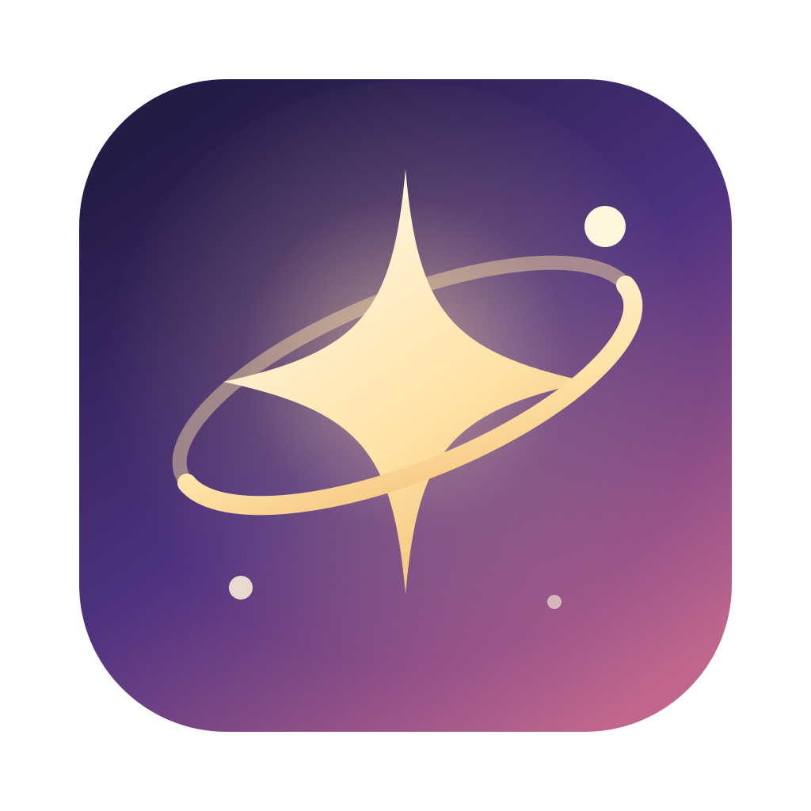
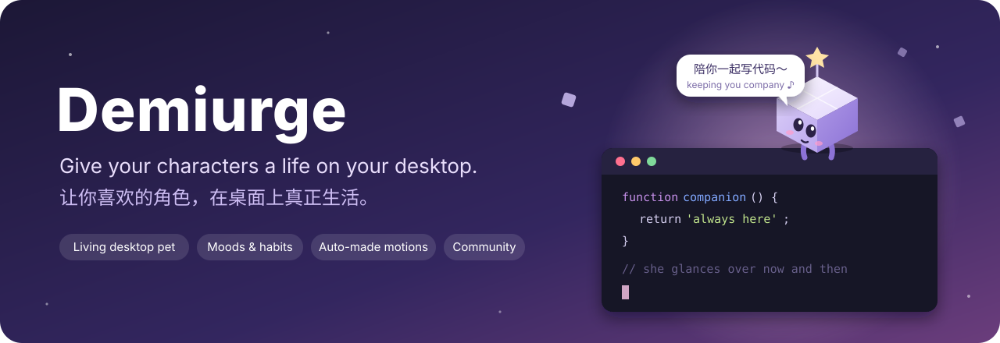

<p align="center">
  
</p>

<h1 align="center">Demiurge</h1>

<p align="center">
  <b>让你喜欢的角色，在桌面上真正生活。</b><br/>
  本地优先的角色陪伴应用：检索角色资料、赋予她声音、做成桌宠，<br/>
  然后让她住在你身边——坐在你正在打字的窗口上，写她的日记，时不时邀请你一起玩。
</p>

<p align="center">
  <a href="README.md">English</a> ·
  <a href="docs/DEMIURGE_USER_GUIDE.md">使用说明</a> ·
  <a href="community/README.md">社区桌宠与插件</a> ·
  <a href="docs/PET_MODULE.md">桌宠模块</a> ·
  <a href="docs/CHANGELOG.zh-CN.md">更新记录</a>
</p>

<p align="center">
  
  
  
  
</p>

<p align="center">
  
</p>

**当前代码版本：0.1.0。** Demiurge 原名 Mori，数据目录、已保存的密钥和 macOS 权限都原样沿用。

## 为什么是 Demiurge

大多数桌宠只是循环播放动画。Demiurge 的角色是**在生活**：她会留意你在做什么，有自己的作息和心情，而且每个角色都像她自己。

|                             |                                                                                                                                                                                         |
| --------------------------- | --------------------------------------------------------------------------------------------------------------------------------------------------------------------------------------- |
| 🪟 **在你工作的地方陪着你** | 你在编辑器里打字，她就跑过来，坐在或趴在那个窗口上，做自己的事，时不时偷看你的屏幕一眼。你太久没理她，她会主动来找你。                                                                  |
| 🎭 **每个角色都是她自己**   | 爱好、小习惯、怎么移动（走、跑、跳或飞）、性格表现（害羞、调皮、活泼、沉稳）都来自角色自己的资料。爱写字的会写日记，爱玩的会打游戏，害羞的被摸头会脸红。                                |
| 💗 **心情是真的**           | 陪她玩会开心，冷落她会寂寞，把她吵醒或从窗口上甩下来会生气。她会闹别扭，直到你摸摸她的头；聊天模型也知道她此刻的心情。                                                                  |
| 🖱️ **有实感**               | 拖动她会晃；拖动她坐着的窗口，她会跑着跟上；猛地拽开窗口，她会掉下去。用指针在她头上来回蹭就是摸头。切换桌面空间或进入全屏应用时，她会从切换的方向跑进来跟着你。                        |
| 💬 **不用打开主窗口也能聊** | 她脚下有输入框，回复出现在她头顶。可以接你自己的聊天模型，也可以不登录任何账号，只用写好的台词。                                                                                        |
| 🎨 **自己做桌宠**           | 给几张参考图，Demiurge 会用几种画风起草角色形象，再逐个生成动作（眨眼、说话、挥手、坐、趴、飞、读书、写字、玩游戏……），逐张核对后打包成经过审核的图集。修正时先经过聊天模型和联网检索。 |
| 🌐 **分享与下载**           | 社区目录里有大家分享的桌宠和纯数据插件，一键安装，每个文件都按记录的校验值核对。                                                                                                        |
| 🔒 **隐私优先**             | 她只知道窗口的位置、最前面的应用、以及距离你上次按键过了几秒，不读取窗口标题、内容或按键。密钥存在系统钥匙串里，所有处理都在你的电脑上完成。                                            |

## 安装

### Windows 10 / 11（64 位）

> Windows 版本刚刚推出，还没有在 Windows 电脑上实际测试过。遇到问题请[提交 Issue](https://github.com/BubbleNNN/Mori/issues)。

1. 在[最新发布页](https://github.com/BubbleNNN/Mori/releases/latest)下载 `Demiurge-<版本>-windows-x64.zip`。
2. _可选：_ 核对下载文件。在 PowerShell 里运行 `Get-FileHash .\Demiurge-<版本>-windows-x64.zip`，显示的 SHA-256 应与旁边一起发布的 `.sha256` 文件一致。
3. 右键压缩包，选择「全部解压缩…」，解压到一个会长期保留的文件夹，例如 `%LOCALAPPDATA%\Programs\Demiurge`。不要直接在压缩包里运行。
4. 打开解压出的文件夹，双击 **Demiurge.exe**。
5. 应用没有代码签名，第一次打开时 Windows 可能提示「Windows 已保护你的电脑」。点击「更多信息」，再点「仍要运行」。
6. 想要快捷方式：右键 `Demiurge.exe`，选择「固定到开始屏幕」，或「显示更多选项 → 发送到 → 桌面快捷方式」。

**更新：** 退出 Demiurge，解压新版本，再删除旧文件夹，角色、聊天和设置都会保留。**卸载：** 删除这个文件夹即可。数据保存在 `%APPDATA%\Mori`（粘贴到资源管理器地址栏打开），一并删除即可清除全部数据。

目前 Windows 版与 macOS 版的区别：

- 她住在你的桌面上，但暂时看不到其他窗口，不会坐到你正在打字的窗口上，也不会跟着你切换虚拟桌面（这部分依赖 macOS 助手）。
- 下载版不包含 Live2D 运行库（它有单独的授权条款），因此无法播放 Live2D 模型；图片和动作桌宠不受影响。
- `Demiurge.exe` 文件本身显示 Electron 的默认图标，窗口和任务栏显示 Demiurge 的图标。

### macOS（Apple 芯片）

暂时没有 macOS 下载，请按下面的方法在 Mac 上构建。应用未签名，第一次请右键选择「打开」。见 [macOS 打包说明](docs/MACOS_RELEASE.md)。

### 从源码运行与构建

需要 Node.js 22.12+ 和 pnpm。

```bash
pnpm install
pnpm setup:live2d        # 可选：Live2D 运行库
pnpm desktop             # 从源码运行，带热更新
node scripts/package-desktop.cjs            # 在 release/ 生成 macOS 应用（在 Mac 上运行）
node scripts/package-windows.cjs --public   # 在 release/ 生成 Windows x64 压缩包（在 Mac 上构建）
```

macOS 上也可以双击 **Start Demiurge Dev.command**。

## 第一次使用

1. 打开应用：示例角色不配置任何接口也能聊天。
2. 点击「放到桌面」，她会跑进来、挥挥手，然后开始过她自己的一天。
3. 把指针移到她脚下会出现工具栏：聊天、活动、小游戏、大小。
4. 在「角色工作室」添加你自己的角色，或者在「社区」下载别人分享的桌宠。

## 工作原理

```
 角色资料 ──► 人设与台词 ──► 聊天（你的模型，或写好的台词）
    │
    ├──► 行为档案 ── 爱好 · 习惯 · 移动方式 · 性格表现
    │
 参考图 ──► 角色形象 ──► 动作表 ──► 核对并审核过的图集
                                     │
 桌面助手（macOS）── 窗口 · 前台应用 · 打字 ──┴──► 桌面生活：作息、心情、
                                                 坐窗口、物理、邀请
```

- **Electron + React + TypeScript**，主进程是普通 CommonJS，约 400 个单元测试。
- 一个小小的 Swift 助手每秒四次报告窗口位置、前台应用、桌面空间顺序和输入时间（只有时间，没有内容）。
- 桌宠是可复用的模块：人设、带动作片段和逐帧审核的图集，以及行为档案。见 [docs/PET_MODULE.md](docs/PET_MODULE.md)。

## 社区

分享你做好的桌宠，或下载别人的直接使用，不用重新制作。插件可以给某个角色或所有角色添加习惯、偏好和台词；插件只是数据，不运行代码。投稿方式见 [community/README.md](community/README.md)。

## 文档

- [使用说明](docs/DEMIURGE_USER_GUIDE.md)：应用的全部功能
- [自动制作桌宠](docs/AUTOMATIC_PET_PRODUCTION.md)：从参考图到图集
- [开发与使用细节](docs/DEVELOPMENT.zh-CN.md)：从源码运行、服务配置、排查问题
- [更新记录](docs/CHANGELOG.zh-CN.md)
- [第三方说明](docs/THIRD_PARTY.md) 与 [素材说明](public/art/README.md)

## 参与贡献

欢迎提 Issue 和 Pull Request，也欢迎给社区目录投稿桌宠和插件。运行 `npx tsc -b && node --test tests/*.test.cjs` 进行检查，详见 [CONTRIBUTING.md](CONTRIBUTING.md)。

如果 Demiurge 让你的桌面温暖了一点，点个 ⭐ 能帮更多人找到它。

## 许可

源代码使用 [MIT 许可证](LICENSE)。角色素材、字体及第三方运行库各自保留权利，见 [THIRD_PARTY.md](docs/THIRD_PARTY.md)。内置示例角色的图像是 AI 二次创作，不是官方素材。部分动作与桌面行为逻辑改编自 [Anime Codex](https://github.com/Lihhan/anime-codex)（MIT）。
