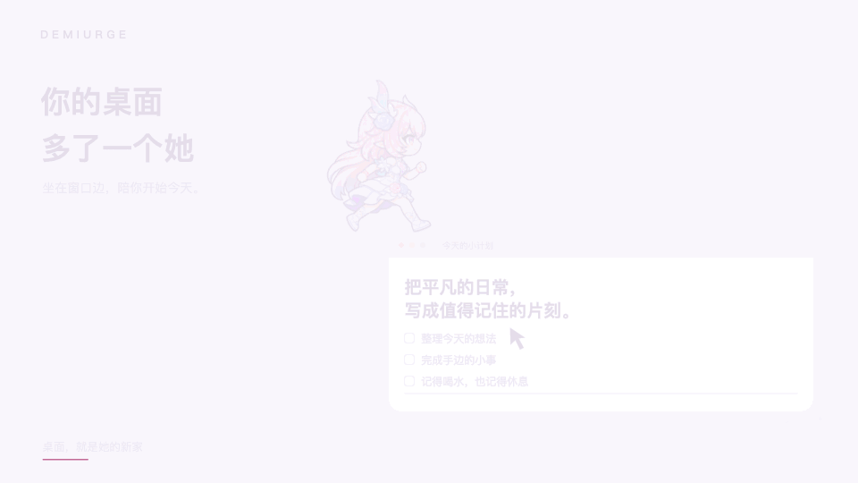
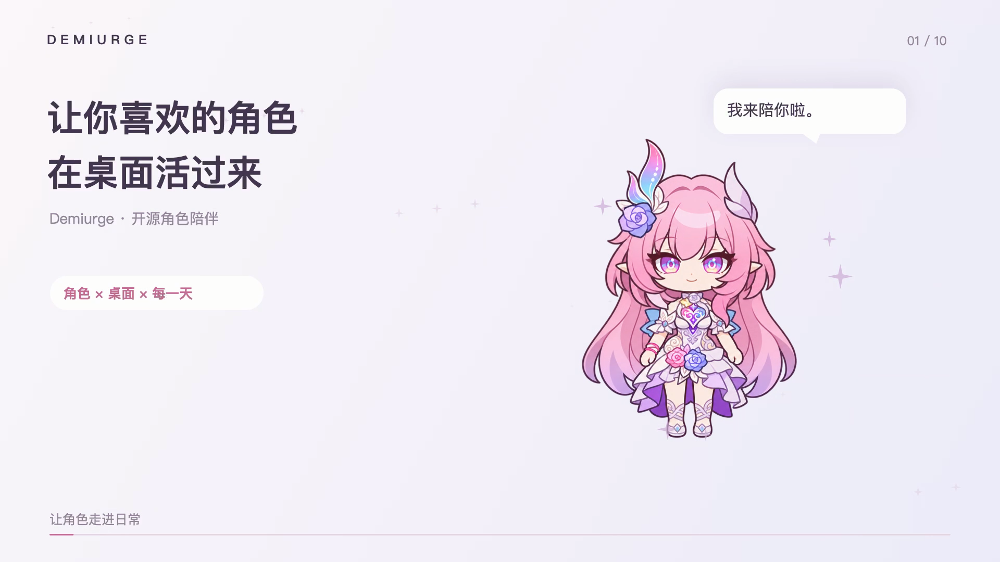
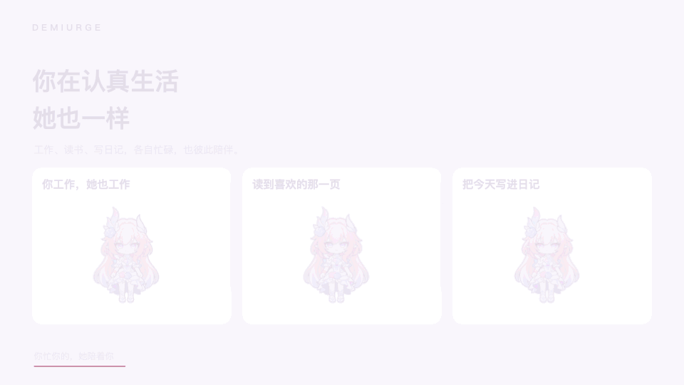
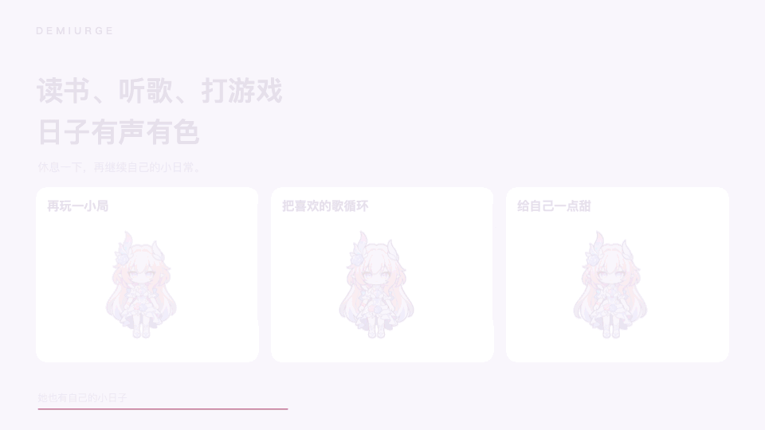
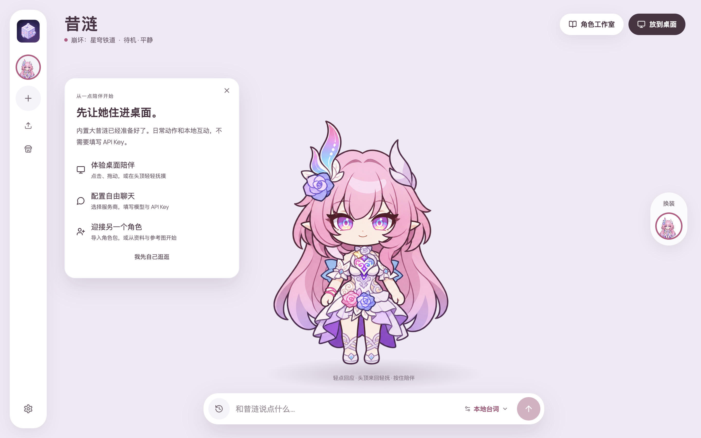

<p align="center"></p>
<h1 align="center">Demiurge</h1>
<p align="center"><b>让你喜欢的角色，在桌面活过来。</b><br/>一起工作，读书，发呆。让熟悉的角色，住进平凡的日常。</p>
<p align="center"><a href="README.md">English</a> · <a href="https://github.com/BubbleNNN/Demiurge/releases/latest">下载 Windows 版</a> · <a href="#新手教程从第一次打开开始">新手教程</a> · <a href="community/README.md">共享社区</a></p>
<p align="center">  </p>



**不止昔涟。** Demiurge 是一个开放的角色陪伴工具，可以创建、导入、制作和分享其他角色。0.1.6 只附带最新版 **大昔涟 · Q版**，让第一次体验直接开始；其他角色需要相应资料和素材，不是输入名字就能保证自动得到完整动画。

## 67 秒，看看她的一天

[](https://github.com/BubbleNNN/Demiurge/releases/download/v0.1.6/demiurge-desktop-life-landscape.mp4)

[横屏视频 · 1920×1080](https://github.com/BubbleNNN/Demiurge/releases/download/v0.1.6/demiurge-desktop-life-landscape.mp4) · [竖屏视频 · 1080×1920](https://github.com/BubbleNNN/Demiurge/releases/download/v0.1.6/demiurge-desktop-life-vertical.mp4)

中文 AI 配音，伴奏《心忆 / Remembrance of the Heart》（HOYO-MiX、林一凡）。视频使用实际桌宠动作和真实社区界面，桌面场景为剪辑合成，聊天是示例台词；不是整段实时录屏。[媒体来源与复现](docs/media/README.md)。

<table><tr><th>各自忙碌，也彼此陪伴</th><th>她也有自己的小日子</th></tr><tr><td></td><td></td></tr></table>

## 可以做什么

- **桌面陪伴**：走动、坐下、趴着、睡觉，读书、办公、写日记、听歌、吃零食、玩游戏。按素材中真实存在的动作播放，不拿整张图摇晃代替动作。
- **有连续性的日常**：结合角色偏好、精力、饥饿和当前任务选择活动。阅读等活动持续数分钟，短暂互动后接着做，不再频繁随机换姿势。
- **触摸与聊天**：点一下、在头顶来回轻抚、拖动位置；回复使用气泡，历史对话可展开。不同角色的回应由资料、性格和可用素材共同约束。
- **角色资料与相处记忆**：个人信息、人物关系、经历、性格、语气规则；标记来源、待核对与剧透。记忆可查看、编辑、删除，区分原作设定与用户关系。
- **制作与分享**：从参考图制作形象和动作，审核后启用；导入/导出角色包，社区共享桌宠与纯数据生活插件。

窗口停靠、跟随前台窗口等功能目前依赖 **macOS 助手**。Windows 版支持桌面桌宠与聊天，暂不具备窗口感知。角色的“心情”和生活行为由程序模拟；模型对话不能保证完全不偏离人设。

## 安装 Windows 版

适用于 Windows 10 / 11 **x64**。无需安装 Node.js、Python 或 Git。

1. 打开 [v0.1.6 发布页](https://github.com/BubbleNNN/Demiurge/releases/tag/v0.1.6)，下载 **Demiurge-0.1.6-windows-x64.zip**。不要下载页面底部的 Source code，它是给开发者的源码。
2. 右键 ZIP → **全部解压缩**，放到一个长期保留的文件夹。不要在压缩包内直接启动，也不要只把 exe 单独拖出来。
3. 在解压后的文件夹中双击 **Demiurge.exe**。首次使用的操作见下一节。
4. 此版本尚未代码签名。若 SmartScreen 提示未知发布者，先确认来自本仓库发布页、核对校验值，再按系统提示选择是否运行。
5. 可为 Demiurge.exe 创建桌面快捷方式。更新时先完全退出应用，解压新版，再删除旧版程序目录；**不要删除 `%APPDATA%\Mori`**，那里保存角色、设置和聊天。

可选校验（PowerShell）：

```powershell
Get-FileHash .\Demiurge-0.1.6-windows-x64.zip -Algorithm SHA256
```

结果应与发布页同名 `.sha256` 文件一致。Windows 包已检查构建和文件完整性，**尚未在 Windows 真机运行验证**；遇到问题请提供系统版本、报错与复现步骤。[反馈问题](https://github.com/BubbleNNN/Demiurge/issues)。

公开 Windows 包不包含另行授权的 Live2D Cubism Core，内置 Q版逐帧桌宠不受影响。exe 文件图标仍为 Electron 默认图标，窗口与任务栏使用 Demiurge 图标。

## 新手教程：从第一次打开开始

### 1. 先体验陪伴，不需要 Key

打开应用会看到大昔涟与初次使用指南。点 **体验桌面陪伴** 或右上角 **放到桌面**。

- 点击角色有短暂回应；在头顶来回移动鼠标是摸头，拖动可换位置。
- 在她附近移动鼠标，使用浮现工具栏选择活动、聊天或大小；读书等动作会保持几分钟。
- 在主窗口的 **连接与设置** 调整桌宠大小、自动生活与声音。不想让她活动时可暂停自动生活，或关闭桌宠窗口。
- 默认是 **本地台词**：不收费、不联网调用模型，但只能回应预设场景，不能自由回答所有问题。



### 2. 想自由聊天，再连接模型

1. 打开左侧 **连接与设置**，找到对话服务。
2. 选择实际使用的服务商。支持 OpenAI 兼容接口、阿里云千问、DeepSeek、豆包、MiniMax、GLM、Anthropic，以及本机 Codex。
3. 填写该服务商的 **API Key、模型名称 / Endpoint ID、服务地址**。切换供应商后同时核对这三项，旧 Key 不会变成新供应商的 Key。
4. 如果平台提供的是完整请求地址，选择对应的完整地址方式，确认页面显示的最终请求地址没有重复追加路径。
5. 保存并测试，在对话区切到 **模型对话**，发送一句问候。

自由聊天用文字模型。**重新生成图片和动画还需要支持参考图的图像模型接口**；只有聊天 Key 不代表能出图。已有桌宠的播放和本地互动不需要图像接口。各平台额度、订阅与 API 计费分别以账号实际权限为准。[供应商与排错说明](docs/CHAT_PROVIDERS_AND_MEMORY.md)。

### 3. 让对话更像她

在 **角色工作室 → 角色档案** 检查资料与语气，使用 **补充资料** 重新整理。可选 Wiki、资料链接、已保存资料等方式；Tavily 不是必填。对站点访问失败，可提供官方资料链接或使用已有资料整理。

核对人物关系、事件时间线、说话特点与剧透范围；未验证的资料保持待核对。自己的设定写在手工设定中，不要冒充原作事实。在记忆页检查与当前角色的相处记录，错误记忆可以修改或删除。

### 4. 添加你喜欢的其他角色

- **已有角色包**：在角色入口或社区导入/安装，选中角色及外观，再放到桌面。
- **自己制作**：点新增角色，填写名字和作品 → 整理资料 → 添加同一形态的参考原图 → 生成并确认形象 → 逐项制作动作 → 核对每帧后启用。
- **已有素材**：可导入兼容图集/角色包，减少重复生成。制作过程中失败的候选不会自动替换已审核的桌宠。

不同角色、画风与模型的生成质量会不同，尤其需要检查手、脸、服装和动作连续性。[完整制作流程](docs/AUTOMATIC_PET_PRODUCTION.md)。

### 5. 分享与共建

打开 **社区桌宠与插件**，可浏览目录、安装生活插件、准备自己的桌宠分享包。社区仍在起步，欢迎成为第一批创作者！发布到仓库目录通过 Pull Request 审核，**应用里的“分享”不会自动把私人聊天或 Key 发到网上**。[投稿指南](community/README.md)。

喜欢这个方向，请点一颗 **Star**。欢迎贡献角色包、生活插件、动作、Windows 测试和界面改进，一起让更多角色活过来。

## macOS 与开发者

macOS Apple 芯片可从源码运行。需要 **Node.js 22.12+** 和 **pnpm 11.25**：

```bash
git clone https://github.com/BubbleNNN/Demiurge.git
cd Demiurge
pnpm install
pnpm desktop
```

可选 Live2D：`pnpm setup:live2d`（遵循第三方授权）。构建和检查：

```bash
pnpm check
pnpm build
node scripts/package-windows.cjs --public  # 在 macOS 上交叉构建 Windows x64
pnpm setup:live2d
node scripts/package-desktop.cjs          # 在 macOS 上构建本机应用
```

项目原名 Mori，沿用数据目录：macOS 为 `~/Library/Application Support/Mori`，Windows 为 `%APPDATA%\Mori`。应用更新不删除用户自己制作的桌宠。窗口助手只读取窗口几何、前台应用与输入时间，不读取屏幕文字或按键内容；模型/搜索请求会向你配置的服务发送相应资料与对话，**不是所有处理都离线**。

## 作者的话

<!-- AUTHOR: 请在这里写下为什么做这个项目、你与角色的故事，以及你想带给用户的陪伴。 -->
> 留给作者：项目的起点与想说的话。

## 你期待的下一步

<!-- AUTHOR: 请填写你确认的路线图、社区联系方式或招募方向；未确认的功能不要写成承诺。 -->
> 留给作者：未来方向与共建邀请。

## 更多文档与许可

[完整使用说明](docs/DEMIURGE_USER_GUIDE.md) · [更新记录](docs/CHANGELOG.zh-CN.md) · [桌宠模块](docs/PET_MODULE.md) · [贡献指南](CONTRIBUTING.md) · [第三方说明](docs/THIRD_PARTY.md)

**代码采用 [MIT](LICENSE)**。角色、音乐、字体、第三方运行库不因开源代码而获得额外授权。大昔涟示例是 AI 同人素材，不是官方角色产品；相关角色权利归原权利方。宣传视频中的《心忆》保留原音乐权利，不属于 MIT。[素材说明](public/art/README.md)。部分桌面行为实现参考 [Anime Codex](https://github.com/Lihhan/anime-codex)（MIT）。
