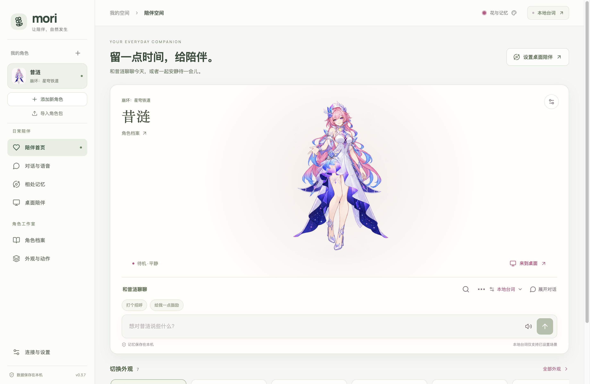

# 更新记录

Demiurge（原名 Mori）各版本的变化，最新的在最前面。

0.1.0 版本号重新从 0.1.0 开始，作为 Demiurge 的第一个公开版本；内容与下面的 0.3.34 相同。安装包里的示例角色图片只保留一份（此前 `dist/art` 和 `public/art` 各一份），Windows 下载从约 354 MB 减到约 247 MB；导出角色包改为从同一份图片读取。切换桌面时她从你来的方向跑进来：切到右边的桌面，她从左边进来（此前方向反了）。「补充动作」「制作修正版」不再被一个用旧参考图做的、已经无法继续的未完成任务挡住；被拒绝时，原因直接显示在按钮下方（此前显示在窗口顶部，看起来像没反应）。桌面上摸头更容易：第一次点她就有反应（此前在别的应用里工作时，第一次点击只会激活桌宠窗口）；鼠标在头顶来回蹭就是摸头：经过发梢外面也算，速度慢一些也行，而且你在别的应用里工作时也有效（此前 macOS 只把鼠标移动发给当前应用，所以蹭她的头没反应；现在由应用自己读取指针位置）；工具栏新增「摸摸头」按钮；坐着或趴着被摸头时不会站起来。macOS 版关闭了 App Nap：此前系统会在你使用别的应用时让 Demiurge 暂停最长约一分钟，她会卡住、点不到。坐下和趴着会待上一阵（平时 45–90 秒，寂寞时 1.5–3 分钟，生气时更久），此前只播放一遍动画（约 3–5 秒）就起身，期间日常安排也不再把她叫起来。心情会改变她做的事：开心时更轻快、常哼歌伸懒腰、爱玩；寂寞时慢慢走、待在你的窗口边看着你；生气时不跑、不来陪你、坐着生闷气、宁可写日记。下面 0.3.x 的记录是改名前的开发历史。

0.3.34 README 增加 Windows 安装说明（下载、核对、解压、SmartScreen、快捷方式、更新与卸载，以及 Windows 版暂时的差别）。`node scripts/package-windows.cjs --public` 构建用于公开下载的版本：使用自带图标而不是你自己的图片，不包含单独授权的 Live2D Cubism Core（图片和动作桌宠不受影响，Live2D 模型无法播放并会明确提示）。Windows 上菜单栏默认隐藏（按 Alt 显示），去掉了只适用于 macOS 的「隐藏」菜单项。

0.3.33 制作桌宠时按角色挑选动作，不再给每个角色都做同一整套：每个桌宠都需要的基础动作（眨眼、说话、表情、招手、点头、摇头、小跳、休息、倾听、被拎起、四向跑动、坐在窗口上）之外，只做她会用到的——她的爱好对应的活动、她习惯的趴着、她靠飞行移动时的飞行。判断来自她的行为档案（角色包写明的、资料里提到的、或按性格推断的），每个动作旁写明原因；不适合她的动作折叠在「不适合她的动作」里，默认不选、不会白白生成，确实需要时仍可手动加上。「补充新动作」同样只预选她缺少且用得到的动作，例如昔涟会补坐下和趴着，不会补飞行。

0.3.32 新增「社区」：侧栏打开，可以下载大家分享的桌宠（直接成为新角色，不用重新制作）和纯数据插件（给角色添加习惯、偏好和台词，不运行代码），每个文件都按社区目录记录的大小和校验值核对；也可以导出自己的角色包并打开 GitHub 分享页面。新增 Windows x64 打包（`node scripts/package-windows.cjs`，尚未在 Windows 上测试，那里的桌宠暂时看不到其他窗口）。README 改为中英双语，开发细节和更新记录移到 [DEVELOPMENT.zh-CN.md](DEVELOPMENT.zh-CN.md) 与本文件，桌宠模块的组成见 [PET_MODULE.md](PET_MODULE.md)。

0.3.31 每个角色按自己的性格生活：最爱的活动、空闲小习惯、移动方式（走、跑、蹦、飞）和摸头戳脸时的反应都来自角色档案；被召唤时从屏幕一侧跑进来，空闲时坐下、趴着、东张西望或哼歌，不再呆站；打字或很久没人理她时会去你的窗口，边做自己的事边偷看你，偶尔主动找你；鼠标在头上来回晃就是摸头；工具栏总在脚下；切换桌面或全屏应用时她会跟过来，从切换方向跑进来；播放时约束头部大小，站立帧里偏大偏小的头会被拉回一致。

0.3.29 可以用自己的图片做应用图标：把 PNG 放在 `private/app-icon.png`（已被 Git 忽略，不会上传），打包时它会放在白色圆角底板上，按图中内容的重心居中并留出边距（主体偏下的图片会被提到中间），用作应用、程序坞和侧栏图标；没有这张图时使用自带的图标。0.3.30 起侧栏图标与下方角色头像同宽并居中。

0.3.28 图标改为 Demiurge 的张量方块：一个由 4×4×4 个小方块组成的立方体，光从缝隙里透出来，几个小方块正从表面浮起，像在运算。（0.3.27 的方块环图标已替换。）

0.3.26 改名为 Demiurge，并换了新图标（应用、程序坞和菜单都显示 Demiurge；数据目录、已保存的密钥和系统权限沿用 Mori 的，不需要迁移）。你在某个窗口里打字时，她会跑到那个窗口上沿坐下或趴着看你，有时也在那里做自己的事；窗口上方没有空间时站在旁边。慢慢拖动窗口时她会跟着跑、保持在窗口上；拖得太快她会摔到屏幕底部，然后跑回去，或坐着生气等你摸头哄她。新增心情：被陪伴会开心，长时间没人理会寂寞，被吵醒、被打断或被甩下窗口会生气，头上会出现 ♪、…、💢，聊天时模型也会知道她的心情。寂寞时她会主动请你陪她聊天或摸摸头，生气时只想被哄。新增「坐下」「趴着」两个动作：新建任务默认包含，已完成的任务可以只补画这两个动作（清晰优先约 6 次图像请求），不必重新制作整套外观。

0.3.25 桌宠会看你在做什么再决定自己做什么：你在编辑器、终端或文档里打字时，她走到你窗口旁边（有空位就不挡住窗口），安静地看着，时不时转头看一眼你的屏幕，或拿出自己的笔记本电脑、日记本、书陪你一起做事；开会时她让开、不说话；你离开一阵子她就自己玩掌机、吃点心、听歌，离开久了会打盹。她只读取前台应用的名称、窗口位置，以及距离上次按键和移动鼠标过了几秒，不读取窗口标题、内容或按键。窗口信息改为持续更新（约每 0.25 秒一次），站在窗口上时跟得更紧，也不再把透明或不可见的窗口当成可站的地方。一起玩的小游戏在桌宠里变成她头顶的小气泡，由她用动作表演（藏星星、猜对时跳一下、猜错时摇头、读书时捧着书），接星星时星星落在她身边，不再用方框挡住她。应用首页的人物在窗口变宽变窄时始终居中。

0.3.24 修正 0.3.23 打开已确认外观时提示「动画图像或时序已经改变，请重新逐帧核对」、无法读取工作区的问题。0.3.23 在启动时改写了已有外观的动作顺序，而已确认外观的核对记录包含动作顺序，因此存档被拒绝（磁盘上的文件没有被改动）。现在改用眨眼静止姿势只发生在播放时，存档和核对记录保持原样；启动时的整理即使保存失败，也会按磁盘上的原样打开工作区，不再锁住。

0.3.23 桌宠可以待在屏幕上任何地方：放到哪里就停在哪里，不再受重力落回屏幕底部，松手时离窗口上沿或地面很近才会站上去；收起后再打开会回到原位。工具栏平时隐藏，鼠标移到她脚下才出现，并加入大小滑块；她说的话在头顶、工具栏在脚下，靠近屏幕边缘时自动换位，不再重叠。去掉了人物下方的名字条。点工具栏的对话按钮，可以在她脚下直接输入并收到头顶的回复，不用打开主窗口。另外修正了动作结束时头部突然变大：自动制作的待机姿势原来是单独画的确认图，头身比例和图像模型画的动作不同；现在待机改用眨眼动作里同样画法的静止姿势，无需重新制作。

0.3.22 修正要求先经过对话模型和搜索：对话模型对照图片理解你的要求并决定要查证的细节，搜索服务查找资料，再由对话模型为图像模型写出具体修正说明；图像模型收不到原始修正文字。修正记录显示对话模型的理解和引用的资料。修正因此需要配置对话模型和搜索服务，每次修正另有约 2 次对话请求和 1 次搜索。

0.3.21 默认「清晰优先」制作动作：每张图只画两到四个姿势，生活、睡觉和跑步等十二帧动作分三张图，眨眼、说话、表情等短动作分两张图，再按共享的中心线和脚底线拼回同一动作。动作帧的像素高度约是之前的 1.8–2.5 倍，接近待机图；完整动作包约 53 次图像请求（节省模式 21 次）。大图集按页保存为本机文件，桌宠只解码正在播放的那一页，工作区文件不再包含整张图集。已完成的旧任务不会自动变清晰，请**新建制作任务**；「节省请求」仍可在制作页选择。

0.3.20 让角色在桌面上生活：她站在屏幕底部、任意窗口的上沿或桌面图标上，按精力、好奇心和亲近度自己走动、爬上窗口、从窗口边上偷看你、跟去你刚切换的窗口、困了在角落打盹；站着的窗口被拖动时会跟着走，窗口关闭或被盖住会掉下来。被拖起时像钟摆一样晃动，松手后受重力落到下方的窗口或地面并有落地动作。主动邀请会等你停顿时才出现，间隔至少十几分钟、每小时最多两次；闲聊每小时最多五句；离开五分钟以上回来时会打招呼。桌宠可在身上滚动或捏合自由缩放（45%–260%），应用首页人物也可滚动、捏合或在人物设置中缩放。外观卡片可删除。眨眼、说话、点头、招手和表情帧直接对齐待机帧，循环动作去掉横向漂移；已完成的任务需在制作页点「重新整理动画（不调用模型）」后生效。

0.3.9 对齐动作制作流程：默认清爽贴纸与完整动作包，生活／跑步动作的进入、循环、退出各四帧；支持坐下、躺下和桌椅道具，共享已完成动作参考，固定位置配准并保留原始像素。请**新建制作任务**使用新版，旧任务仍按原布局续跑。见 [0.3.9 制作流程更新](MORI_0_3_9_RELEASE.md)。

0.3.8 将 Anime Codex 的四向跑动、被拎起、睡醒与跑停过渡、桌面感知和自主探索接入 Demiurge，修复桌宠邀请无法接受的问题。入口、兼容性及验证边界见 [迁移说明](ANIME_CODEX_MIGRATION.md)。已有外观需要补齐新动作后才能播放，不会自动生成或替换素材。

0.3.7 重整了工作区：单侧栏区分「日常陪伴」与「角色工作室」，首页把角色和输入框放在同一张卡片里，外观页优先展示自动制作与已保存外观，导入工具和动作调节按需展开。视觉与验收说明见 [0.3.7 界面更新](MORI_0_3_7_RELEASE.md)。

初次启动默认本地台词模式，明确标注已编写的回应，不伪装成模型回答。昔涟保留原作画风、精绘、Q 版、飞天小女警、复古像素、8-bit 和低多边形 3D 七套外观，每套都有 16 张姿势帧，支持待机呼吸、眨眼、口型、招呼、点头和闭眼休息。模型对话需配置真实服务，缺少配置不会静默切换成本地回答。昔涟初始语气依据已读取的 HoYoWiki 问候与爱好语音提炼；本地互动台词是可编辑的二次创作，未整理的剧情保持未知。

新增人物支持本机草稿恢复、同名同作品档案续接和五项准备进度；切换人物会记住各自的已确认外观。「桌宠窗口」提供三档大小与实时预览，逐帧角色只在可见像素上响应触摸。对话按角色台词和近期表达组织上下文，并再次检查动作是否符合语境。实现、验证与能力边界见 [本轮产品完善记录](PRODUCT_REFINEMENT_2026_10_07.md)。

「角色档案 → 角色试聊」支持独立的多轮对话，每段最多 8 轮。可以逐条标记是否贴合角色、记录语气或设定问题，再复制摘要并调整档案；试聊不写入正式聊天或个人记忆，关闭窗口后清除。新角色首页会按现有资料推荐下一步，不要求完整导入的角色包重新补原图。见 [第二轮完善记录](PRODUCT_REFINEMENT_ROUND2_2026_10_07.md)。

自动制作新增「先看角色图再继续」、可保存的外观要求、自然／轻柔／活泼动作气质，以及可选实验性八帧。四帧仍为默认，八帧需要横向图像编辑支持；旧任务可继续。GitHub 调研、实现与验证边界见 [2026-10-22 制作改进](PET_PRODUCTION_UPGRADE_2026_10_22.md)。

0.3.0 进一步支持每种画风生成 1–3 张形象候选、选定后制作动作、只重绘一个不满意的动作，或修正角色形象后重做该画风。每份修正版保留原任务和原成品，核对后再启用。连接设置新增完整工作区 ZIP 备份与恢复，包含聊天、记忆、模型和制作任务；存档损坏时可显式恢复上一份有效存档，密钥解密失败也能继续本地陪伴。具体交付和测试见 [0.3.0 完善记录](MORI_0_3_RELEASE.md)。

0.3.1 补上视觉核对：候选图可与任意一张参考图并排放大，支持 100%–300% 缩放、透明格和深浅底色；修正版可与来源成品同时试播同一个动作并反复重播。查看、放大和试播不会新增模型请求，也不会替你选定候选。实现与截图见 [0.3.1 视觉核对改进](MORI_0_3_1_RELEASE.md)。

0.3.2 把形象修正提前到候选阶段：点击「修正这张」，填写要求后仅新增一次图像编辑。新旧候选同时保留，并停下来等待选择，再制作动作；修图失败仍可使用原候选，本机保存恢复不会再次请求模型。见 [0.3.2 候选修图改进](MORI_0_3_2_RELEASE.md)。

0.3.3 增加独立画风参考：角色原图保持身份与服装，另一张图片只参考线条、上色方式和材质；任务保存自己的参考副本，动作沿用选定角色图。候选核对新增 96／160／240 像素高度的小尺寸预览，便于判断缩小后的脸部与轮廓。见 [0.3.3 画风参考与预览](MORI_0_3_3_RELEASE.md)。

0.3.6 新增读书与掌机活动：每组八帧，包含进入、循环与收起道具；支持制作审核、成品试播和桌宠工具栏，活动约一分钟后回到待机。见 [0.3.6 生活活动说明](MORI_0_3_6_RELEASE.md)。

0.3.5 借鉴本机 Anime Codex：新增清爽贴纸画风，自动整理略有尺寸偏差的图集，排除只有透明像素或轻微噪点变化的无效动作，并清理贴纸成品的低透明度残留。见 [0.3.5 适配说明](MORI_0_3_5_RELEASE.md)。

0.3.4 让多候选带有可比较的设计方向：「均衡表现」「鲜明轮廓」「柔和神态」。生成前可查看说明，也可选择同一方向微调；方向随候选保存，修图与动作沿用选定外观。旧任务保持原有方式。见 [0.3.4 候选设计方向](MORI_0_3_4_RELEASE.md)。
