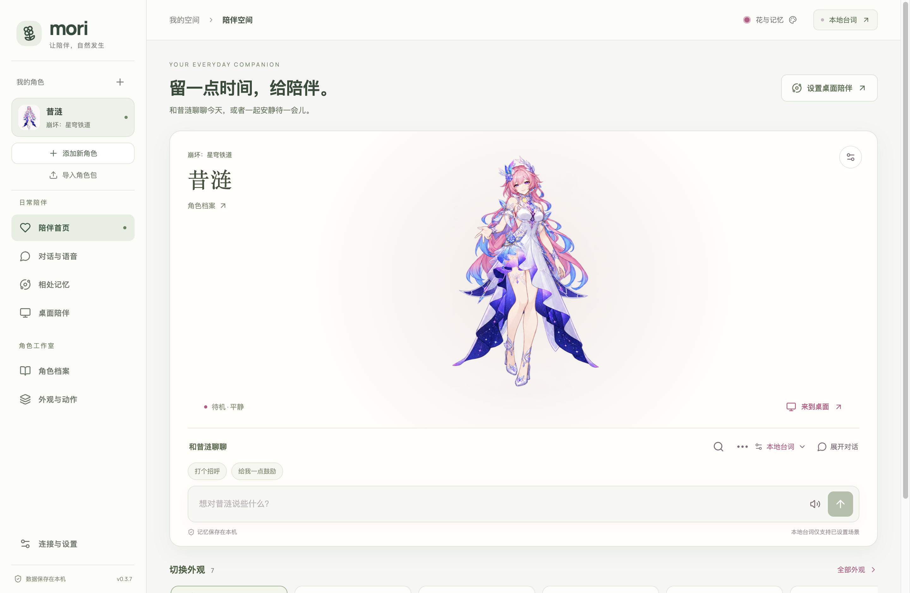
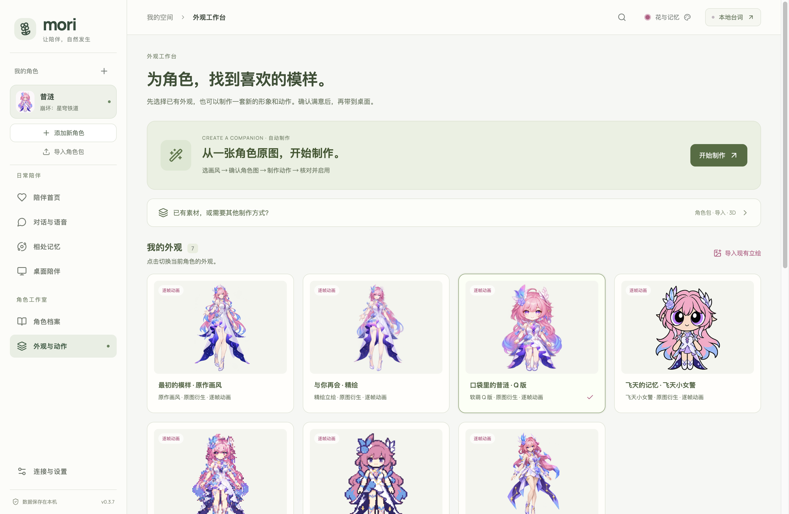

# Mori 0.3.7 · 工作区与操作入口

本次调整解决双侧栏占用空间、制作入口同级堆叠，以及首页输入框位置偏低的问题。

## 操作结构

- 一条侧栏保留当前角色选择；功能分为日常陪伴与角色工作室，设置固定在底部。
- 首页采用暖白与鼠尾草绿的工作区底色，角色主题色继续用于外观和部分强调。角色卡片包含人物、回复和聊天输入，首屏提供桌面设置入口。
- 外观页显示自动制作与已有外观；角色包、导入、3D 等工具按需展开；动作预览独立收起。选择卡片具有可访问的选中状态。
- 长回复限制在人物展示区内滚动，保留底部操作空间；去除旧底栏的毛玻璃遮罩，避免角色脚部被模糊遮挡。宽屏与 900 像素窗口保持可用。
- 制作、候选确认、像素审核、密钥存储、聊天和记忆规则保持原有行为；本次没有新增内置画风素材。

## 检查方式

`pnpm check` 验证类型和源码测试；`pnpm build` 构建前端。

`test-workspace-design-desktop.cjs` 在隔离工作区验证七个页面、窄窗溢出、外观切换、角色包与自动制作弹窗、高级工具与动作面板。网络请求被测试替身拒绝，截图仅包含内置示例角色。

`test-companion-layout-desktop.cjs` 验证物理点击、触摸冷却、休息/唤醒、对话草稿、页面切换、保存失败恢复和长回复布局。更新了旧脚本对 8-bit 无点头动作、设置仅六组的过期假设，并在角色回复结束后执行触摸。

打包时仅把 PNG 复制到运行时素材目录，示例素材说明单独保存在 `licenses/ARTWORK.md`。Live2D Core 仅用于本机包，仍受 Git 忽略。

最终检查结果记录在本机 `.local/ui-*` 日志、`artifacts/workspace-ui` 和 `artifacts/macos-release-arm64`。公开仓库不提交用户数据与运行日志；README 的页面截图来自隔离工作区。

## 本机结果

- 320 项源码测试通过，TypeScript 检查和生产构建通过。
- 工作区界面验收通过：7 个页面与 900 像素宽的首页、外观页均无横向溢出；外观切换、制作弹窗、角色包和折叠面板可用；API 调用为 0。
- 陪伴交互验收通过：真实鼠标输入、冷却、休息唤醒、草稿保留、保存故障恢复和长回复位置均通过；注入的保存错误是测试预期情形。

